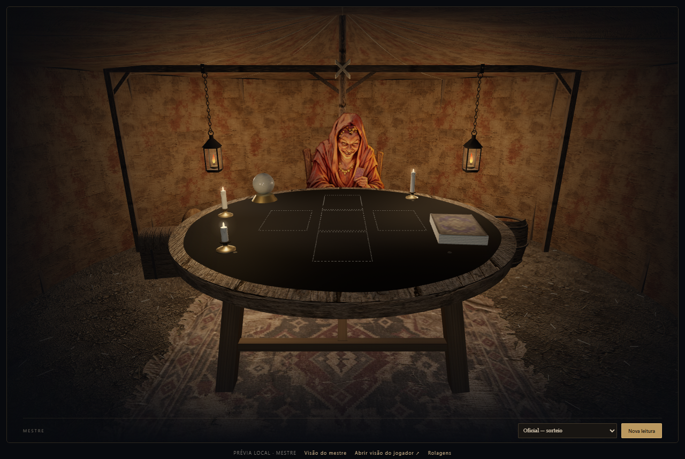
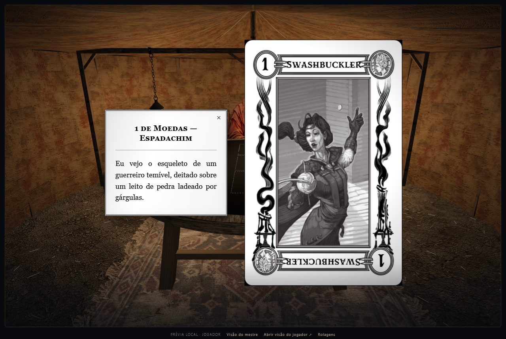

# Leitura Tarokka — Madame Eva

Leve seus jogadores à tenda de Madame Eva no Foundry VTT: uma mesa 3D com cartas animadas, profecias em português e leitura compartilhada entre mestre e jogadores. Inclui os modos **Oficial** e **Curse of Strahd: Reloaded**, além de integração opcional com **Dice So Nice**.

## Imagens do módulo

**A mesa de Madame Eva**



**Cartas ampliadas e profecias em português**



## Instalação

No Foundry, abra **Módulos adicionais → Instalar módulo** e cole este link no campo **Manifest URL / URL do manifesto**:

```text
https://github.com/Crespo767/tarokka-reading/releases/latest/download/module.json
```

Depois, abra seu mundo e ative o módulo. Para instalação manual, baixe o ZIP na [última release](https://github.com/Crespo767/tarokka-reading/releases/latest) e extraia a pasta `tarokka-reading` em `Data/modules/`.

Compatibilidade declarada: **Foundry v12 e v13**.

## Como jogar

Abra a mesa pelos controles de tokens ou pelo menu de clique direito no token de **Madame Eva**. Também é possível usar uma macro com `game.tarokka.open()`; para abrir para todos, use `game.tarokka.openForAll()`.

O mestre escolhe o modo da leitura, e os jogadores podem pedir a próxima carta. Clique nas cartas reveladas para ampliá-las e ler suas profecias. Use **Nova leitura** para recomeçar.

O compêndio **Curse of Strahd & Ravenloft | Compêndios PT-BR** é opcional para importar o ator de Madame Eva. As notas reservadas ficam disponíveis somente para o mestre.
